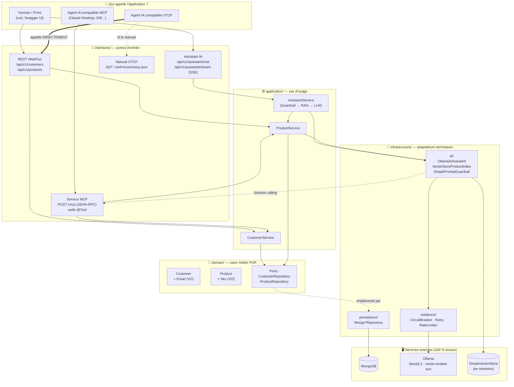
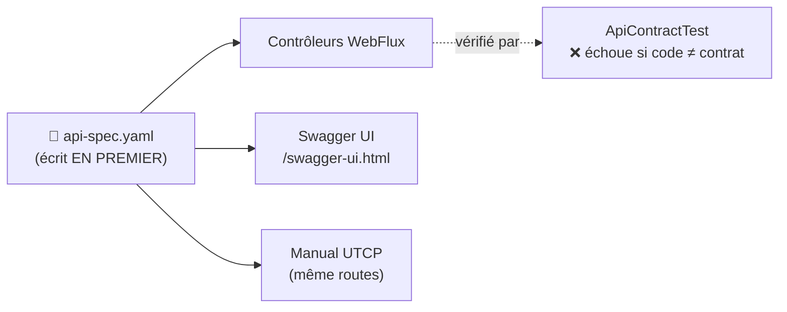
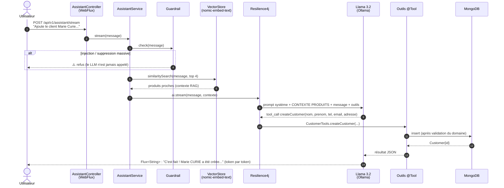
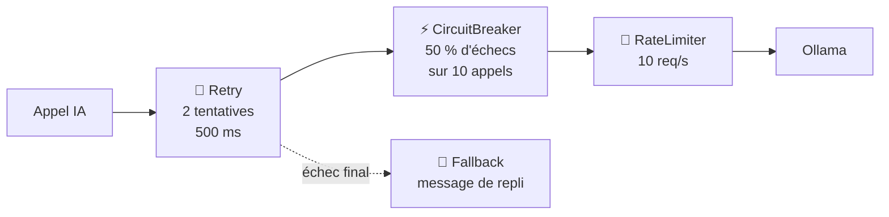
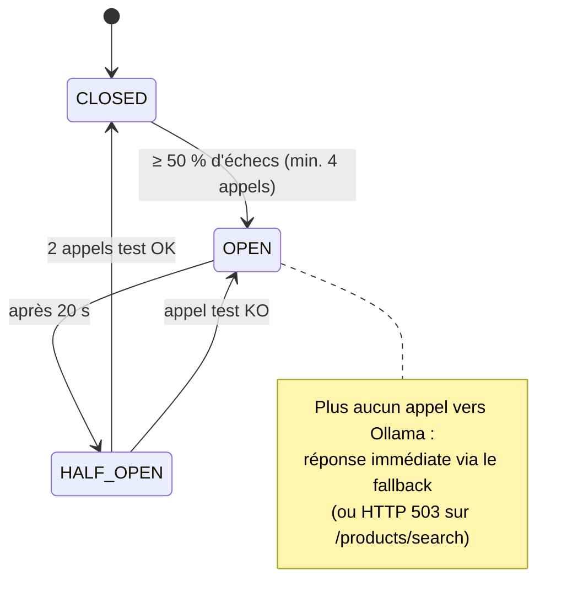
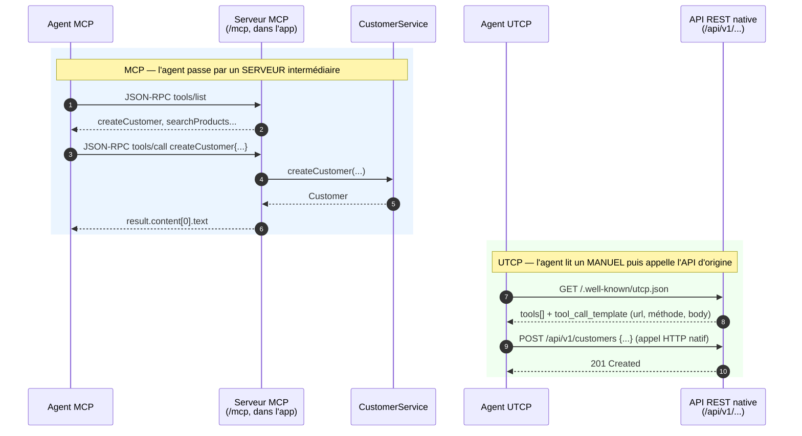
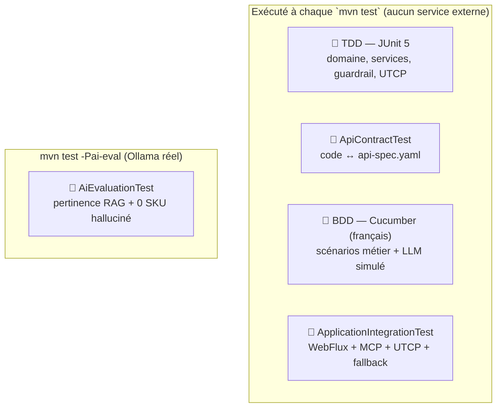
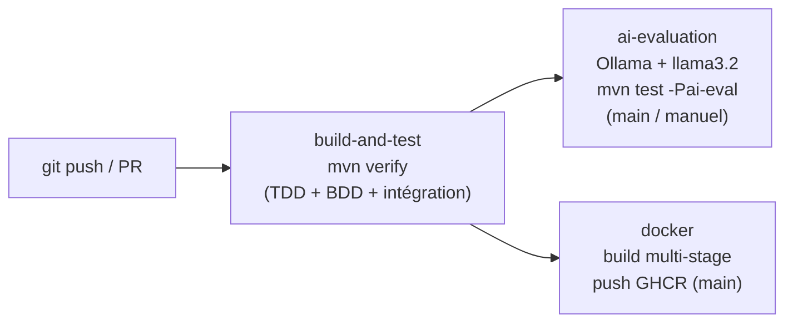

# 🧭 Blueprint d'architecture — Customer & Product AI

> Objectif : montrer, sur un domaine volontairement banal (des **clients** et des **produits**),
> comment s'articulent concrètement **DDD, API-First, IA-First, WebFlux, MongoDB, Spring AI / Llama,
> Resilience4j, MCP, UTCP, TDD, BDD et CI/CD**.

---

## 1. Vue d'ensemble

**La règle d'or (DDD / hexagonal)** : les flèches de dépendance pointent **vers le domaine**.
Le package `domain` n'importe ni Spring, ni MongoDB, ni Spring AI : seulement Reactor (`Mono`/`Flux`),
un choix assumé pour un domaine réactif.

---

## 2. Les couches DDD, concrètement

| Couche | Package | Contient | Dépend de |
|---|---|---|---|
| **Domaine** | `domain/` | `Customer`, `Product` (agrégats), `Email`, `Sku` (Value Objects), ports `*Repository`, exceptions métier | rien (Java + Reactor) |
| **Application** | `application/` | `CustomerService`, `ProductService`, `AssistantService`, ports `AiAssistantPort`, `ProductSemanticIndex`, `InputGuardrail` | domaine |
| **Infrastructure** | `infrastructure/` | Documents + repositories MongoDB, Spring AI (ChatClient, VectorStore), guardrail, Resilience4j, données de démo | application, domaine, frameworks |
| **Interfaces** | `interfaces/` | Contrôleurs REST, outils MCP `@Tool`, Manual UTCP, gestion d'erreurs | application |

### Où vivent les règles métier ?

| Règle | Où | Test |
|---|---|---|
| Email valide et normalisé en minuscules | `Email` (VO) | `EmailTest` |
| SKU au format `ABC-123`, en majuscules | `Sku` (VO) | `SkuTest` |
| Nom/prénom/adresse obligatoires, téléphone 10–15 chiffres | `Customer` | `CustomerTest` |
| Description ≥ 10 caractères (elle alimente le RAG) | `Product` | `ProductTest` |
| Le SKU est l'identité métier → **non modifiable** | `Product.update()` + `ProductService` | `ProductTest`, `ProductServiceTest` |
| Email et SKU **uniques** | `CustomerService`, `ProductService` (+ index unique MongoDB) | `*ServiceTest`, BDD |

---

## 3. API-First

1. On écrit `src/main/resources/openapi/api-spec.yaml` (routes, schémas, codes d'erreur RFC 9457).
2. Les contrôleurs implémentent exactement ces opérations.
3. `ApiContractTest` compare **automatiquement** les opérations du contrat et celles du code :
   une route oubliée ou non documentée casse le build.

---

## 4. IA-First : le parcours d'une question

**Deux mécanismes complémentaires :**

| Mécanisme | Quand | Comment |
|---|---|---|
| **RAG** (Retrieval-Augmented Generation) | « Quel produit pour le télétravail ? » | `Product.description` est vectorisée (nomic-embed-text) dans un `SimpleVectorStore`. Les 4 produits les plus proches sont injectés dans le prompt. |
| **Function calling** | « Ajoute le client… », « Liste les produits » | Le LLM reçoit la liste des outils `@Tool` et décide lui-même d'appeler `createCustomer`, `searchProducts`… |

**Anti-hallucination :** prompt système strict (« n'invente jamais de SKU »), température basse (0.2),
`candidateSkus` renvoyés dans la réponse (traçabilité), et test `AiEvaluationTest` qui vérifie que
**tout SKU cité par le LLM existe réellement**.

---

## 5. Résilience (Resilience4j)

Points d'attention (et pourquoi) :

* **Une seule couche de retry.** Spring AI possède son propre `RetryTemplate` (10 tentatives,
  backoff jusqu'à 3 min !). Il est désactivé (`spring.ai.retry.max-attempts: 1`) : sinon une panne
  d'Ollama bloquerait chaque requête pendant de longues minutes.
* **Le fallback est porté par `@Retry`**, la couche la plus externe : si on le mettait sur
  `@CircuitBreaker`, le Retry ne verrait jamais d'erreur et ne réessaierait jamais.
* **Le CRUD ne dépend pas de l'IA.** Si l'indexation (embeddings) échoue, le produit est quand même
  enregistré dans MongoDB ; l'index est reconstruit au prochain démarrage.
* **Observabilité** : `GET /actuator/circuitbreakers`, `/actuator/health`, et logs `⚡`/`🔁`.

---

## 6. MCP vs UTCP, appliqués à ce projet

| Critère | **MCP** (`POST /mcp`) | **UTCP** (`GET /.well-known/utcp.json`) |
|---|---|---|
| Philosophie | « Un protocole et un serveur dédiés aux agents » | « Un manuel qui décrit comment appeler l'existant » |
| Transport | JSON-RPC 2.0 (ici : HTTP *stateless*) | Le protocole natif de l'outil (ici : HTTP/REST) |
| Code à écrire | Classes `@Tool` (`CustomerTools`, `ProductTools`) | Un document JSON (`UtcpManualController`) |
| Chemin d'un appel | Agent → serveur MCP → service | Agent → API REST → service (**un saut de moins**) |
| Sécurité / auth | Gérées par le serveur MCP | Celles de l'API existante (rien à dupliquer) |
| Écosystème | Très large (Claude Desktop, IDE, frameworks d'agents) | Plus jeune, en croissance |
| Idéal pour | Outils « pensés pour l'IA », logique d'orchestration côté serveur | Exposer à des agents une API qui existe déjà, sans wrapper |

**Dans ce projet, les deux coexistent sans duplication de logique métier** : outils MCP, API REST et
assistant interne appellent tous les mêmes services applicatifs.

---

## 7. Stratégie de tests

| Type | Fichiers | Ce qu'on prouve |
|---|---|---|
| TDD | `domain/*Test`, `application/*Test` | Les règles métier, sans framework, en millisecondes |
| BDD | `features/customer_product_ai.feature` | Le comportement attendu, lisible par un non-développeur |
| Contrat | `ApiContractTest` | API-First tenu dans la durée |
| Intégration | `ApplicationIntegrationTest` | Câblage Spring, sérialisation, MCP, UTCP, fallback |
| Évaluation IA | `AiEvaluationTest` (tag `ai-eval`) | Le vrai Llama recommande des produits existants, n'en invente pas |

---

## 8. CI/CD

Fichier : `.github/workflows/ci-cd.yml`. Image : `Dockerfile` multi-stage (JDK + Maven pour construire,
JRE seul + couches Spring Boot extraites pour exécuter, utilisateur non-root).

---

## 9. Choix techniques et limites assumées

| Choix | Pourquoi | Pour aller en production |
|---|---|---|
| `SimpleVectorStore` en mémoire | Zéro infra en plus | PgVector, MongoDB Atlas Vector Search, Qdrant… |
| Reactor dans le domaine | Pragmatisme dans une app 100 % réactive | Ports purement synchrones si le domaine doit être réutilisé ailleurs |
| Outils `@Tool` synchrones (`block()` borné) | API Spring AI ; exécutés sur `boundedElastic` | Outils réactifs quand l'API le permettra |
| Guardrail à base de regex | Lisible et testable | Modèle de modération + garde-fous de sortie |
| Pas d'authentification | Lisibilité de la démo | OAuth2 / JWT sur REST, MCP et UTCP (champ `auth` du manuel) |
| Pas de mémoire de conversation | Simplicité | `MessageChatMemoryAdvisor` + `conversationId` |
